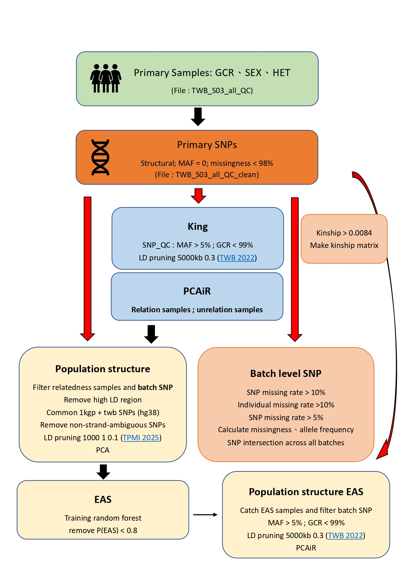
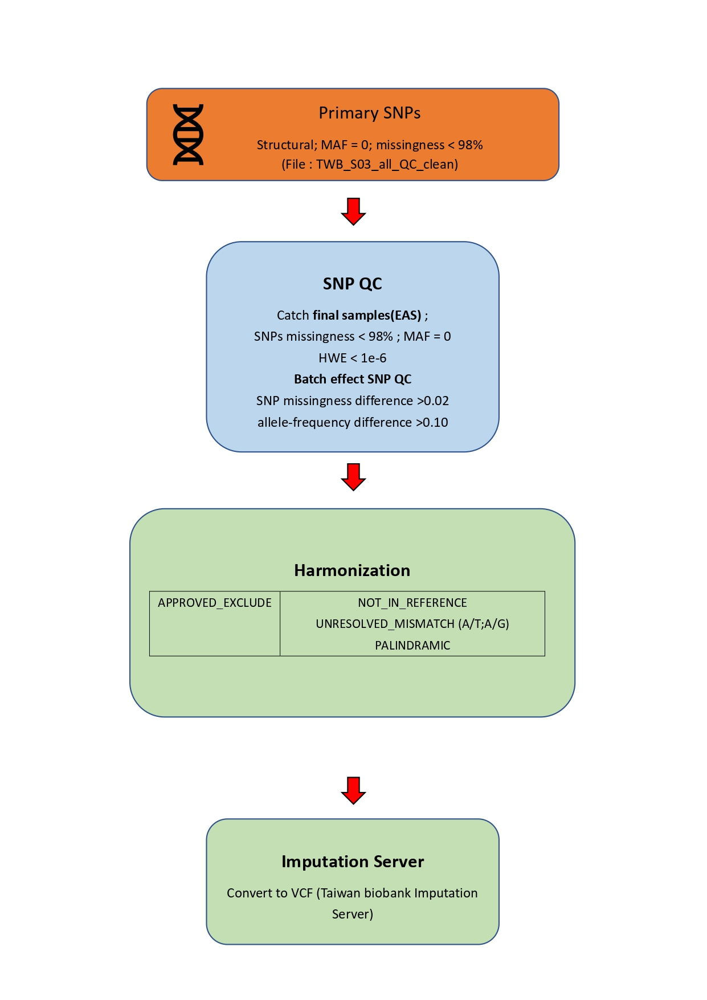

# Genomic Data Sources

This repository uses genomic data from the following datasets:

- Taiwan Biobank (TWB)
- 1000 Genomes Project (1KGP)
- Simons Genome Diversity Project (SGDP)

## 1. Taiwan Biobank (TWB)

- **Data source:** [Taiwan Biobank](https://www.biobank.org.tw/)
- **TWB1**
  - Reference genome: `GRCh37`
  - Reference publication: [ScienceDirect](https://www.sciencedirect.com/science/article/pii/S2666979X2200146X)
- **TWB2**
  - Reference genome: `GRCh38`
  - Reference publication: [Nature](https://www.nature.com/articles/s41586-025-09680-x)

## 2. 1000 Genomes Project (1KGP)

- **GRCh37**
  - Data release: `20130502`
  - Download: [1000 Genomes GRCh37](https://ftp.1000genomes.ebi.ac.uk/vol1/ftp/release/20130502/)
- **GRCh38**
  - Download VCF from [1000 Genomes GRCh38](https://ftp.1000genomes.ebi.ac.uk/vol1/ftp/data_collections/1000G_2504_high_coverage/working/20201028_3202_phased/)
  - Phased dataset: `20201028_3202_phased`
- SNP data 
  - Format: PLINK binary fileset
  - Sample: unrelated samples (Refer to 1kGP.3202_samples.pedigree_info.txt ([download](http://ftp.1000genomes.ebi.ac.uk/vol1/ftp/data_collections/1000G_2504_high_coverage/working/))) for additional information
  - Autosome (chr1~chr22)
  - Exclusions: SNPs in high linkage disequilibrium (LD) regions ([download](https://genome.sph.umich.edu/wiki/Regions_of_high_linkage_disequilibrium_(LD)))

## 3. Simons Genome Diversity Project (SGDP)

- **GRCh37**
  - Download VCF from [SGDP VCF Variants](https://sharehost.hms.harvard.edu/genetics/reich_lab/sgdp/vcf_variants/)

- **GRCh38**
  - LiftOver 

- SNP data
  - Format: PLINK binary filest
  - Sample: Oceania, EastAsia, SouthAsia
  - Autosome (chr1~chr22)
- Sample information: 
  SGDP_metadata.279publiu.21signedLetter.44Fan.samples.txt ([download](https://sharehost.hms.harvard.edu/genetics/reich_lab/sgdp/SGDP_metadata.279public.21signedLetter.44Fan.samples.txt))
 
# Repository Structure
- 1kGP_SGDP_prep/ — Reference-data preparation directory.
- TWB1_genotyped_GP_v20251211_n27652/ — TWB1 genotype-processing directory.
- TWB2_genotyped_GP_v20251211_n138615/ — TWB2 genotype-processing directory.

# Taiwan Biobank (TWB) Genotype Quality Control Pipeline

## Overview

This repository documents the genotype quality control (QC) workflow for Taiwan Biobank (TWB) data.

## 1. Primary Sample QC

Perform initial sample-level quality control.

- Genotype Call Rate (GCR)
- Sex concordance (SEX)
- Heterozygosity (HET)

**Output:**
- `TWB_S03_all_QC`

## 2. Primary SNP QC

Perform initial SNP-level quality control.

- Structural variant filtering
- Minor Allele Frequency (MAF = 0)
- SNP missingness < 98%

**Output:**
- `TWB_S03_all_QC_clean`

## 3. Relatedness and Kinship Analysis

### KING

Identify genetic relationships between samples.

- SNP QC:
  - MAF > 5%
  - GCR < 99%
- LD pruning:
  - Window size: 5000 kb
  - LD threshold: 0.3
  - Reference: TWB 2022
- Kinship threshold:
  - Kinship > 0.0084
- Generate kinship matrix.

### PCAiR

Perform principal component analysis accounting for relatedness.

- Identify related samples.
- Identify unrelated samples.
- Perform PCAiR analysis.

## 4. Population Structure Analysis

Evaluate population structure using TWB and 1000 Genomes Project (1KGP) reference data.

### Preprocessing

- Filter related samples.
- Filter batch-effect SNPs.
- Remove high-LD regions.
- Extract common SNPs between 1KGP and TWB (hg38).
- Remove non-strand-ambiguous SNPs, as specified in the workflow.

### LD Pruning

- Window size: 1000
- Step size: 1
- LD threshold: 0.1
- Reference: TPMI 2025

### Principal Component Analysis

- Perform PCA.
- Evaluate population structure.
- Identify East Asian (EAS) ancestry samples.

## 5. Genetic Ancestry Classification

Classify samples using a Random Forest model.

- Train a Random Forest classifier.
- Estimate East Asian ancestry probability.
- Remove samples with:
  - P(EAS) < 0.8
- Retain EAS samples for downstream analyses.

## 6. Batch-Level SNP QC

Perform quality control for each genotyping batch.

### Missingness Filtering

- SNP missing rate > 10%
- Individual missing rate > 10%
- SNP missing rate > 5%

### Batch Comparison

- Calculate SNP missingness.
- Calculate allele frequency.
- Identify common SNPs across all batches.
- Generate SNP intersection across batches.

## 7. EAS Population Structure Analysis

Perform population structure analysis using selected EAS samples.

- Extract EAS samples.
- Filter batch-effect SNPs.
- Apply SNP QC:
  - MAF > 5%
  - GCR < 99%
- Perform LD pruning:
  - Window size: 5000 kb
  - LD threshold: 0.3
  - Reference: TWB 2022
- Perform PCAiR analysis.

## 8. Final SNP QC

Perform SNP quality control using the final EAS sample set.

### SNP Filtering

- Extract final EAS samples.
- SNP missingness < 98%
- MAF = 0
- Hardy-Weinberg Equilibrium:
  - HWE < 1e-6

### Batch Effect SNP QC

Identify SNPs with potential batch effects.

- SNP missingness difference > 0.02
- Allele frequency difference > 0.10

## 9. Genotype Harmonization

Perform genotype harmonization before imputation to ensure allele consistency with the reference panel.

### Variant Categories

- `APPROVED_EXCLUDE`
  - `NOT_IN_REFERENCE`
  - `UNRESOLVED_MISMATCH`
  - `PALINDROMIC`
- `APPROVED_FLIP`
  - `STRAND_FLIP`
- `APPROVED_KEEP`
  - `MATCH`
  - `ALLELE_ORDER_SWAP`

### Harmonization Procedures

- **Exclude variants:**
  - Remove all palindromic SNPs (A/T and C/G).
  - Remove SNPs with unresolved allele mismatches.
  - Remove SNPs not present in the reference panel.

- **Strand flipping:**
  - Apply strand flipping to variants classified as `STRAND_FLIP`.
  - Convert alleles to their complementary bases (A ↔ T, C ↔ G).

- **Allele swapping:**
  - Swap allele order for variants classified as `ALLELE_ORDER_SWAP`.
  - Ensure allele orientation matches the reference panel.

- **Retain variants:**
  - Keep variants classified as `MATCH`.
  - Keep successfully harmonized variants after strand flipping or allele swapping.

## 10. Genotype Imputation

Prepare genotype data for imputation.

- Convert genotype data to VCF format.
- Submit VCF files to the Taiwan Biobank Imputation Server.
- Perform genotype imputation.

## Quality Control Summary

Summary of genotype quality control (QC) procedures for Taiwan Biobank Phase 1 (TWB1) and Phase 2 (TWB2).

| Step | TWB1 Samples/SNPs | TWB2 Samples/SNPs | QC Criteria / Notes | Output File |
|---|---|---|---|---|
| **Original** | Samples: 27,652 SNPs: 646,973 | Samples: 138,615 SNPs: 686,370 | Raw genotype data | - |
| **Primary Sample QC** | Samples: 27,323 SNPs: 646,973 | Samples: 136,984 SNPs: 646,973 | GCR, SEX, HET | - |
| **Primary SNP QC** | Samples: 27,323 SNPs: 611,991 | Samples: 138,615 SNPs: 571,914 | Structural SNP filtering: MAF = 0 Missingness < 98% | `TWBX_S03_all_QC_clean` |
| **EAS Kinship Filtering** | Samples: 25,206 SNPs: 611,898 | Samples: 136,984 SNPs: 539,122 | Remove batch-associated SNPs Remove related samples (Kinship > 0.0884) | `TWBX_S05` |
| **Meta PCA** | Samples: 25,206 SNPs: 62,944 | Samples: 136,984 SNPs: 47,514 | Combined datasets: 1KGP + SGDP + TWB | `TWBX_S05_pca` |
| **EAS PCAiR** | Samples: 25,205 SNPs: 147,313 | Samples: 136,979 SNPs: 142,833 | Select EAS samples Remove batch-associated SNPs MAF < 0.05 Missingness < 99% LD pruning: 5000 kb, r² = 0.3 | `TWBX__EAS_pcair_kin` |
| **Final SNP QC** | Samples: 25,205 SNPs: 586,508 | Samples: 136,979 SNPs: 479,138 | Start from Primary SNP QC Select EAS samples SNP missingness < 98% MAF = 0 HWE < 1e-6 Batch-effect SNP filtering | `TWBX_F_SNPQC05_clean` |
